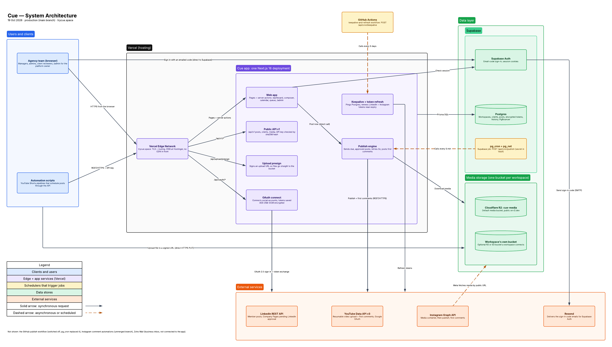

# Architecture

**Live diagram:** [Cue — System Architecture in Lucidchart](https://lucid.app/lucidchart/49e536c1-34d2-4dff-8b21-d2604ef113e3/edit?invitationId=inv_627ef57c-cab7-462e-b7a7-788e10fe3110)
(view only; sign in to Lucid to open it). Checked against the code on 19 Oct 2026.

Cue is one Next.js 16 app on Vercel. The pages, the public API, the OAuth
connect routes and the publisher all ship in the same deployment. There are no
separate backend services, containers or queues. Requests reach it through
Vercel's edge network on `trycue.space`. DNS is at Hostinger and nothing sits in
front of Vercel: the Cloudflare move in
[dns-migration-cloudflare.md](dns-migration-cloudflare.md) hasn't happened yet.

The agency team uses Cue in the browser. Sign-in goes from the browser straight
to Supabase Auth, which emails a one-time code through Resend. After that, the
app checks the session cookie on every request. Automation scripts (the YouTube
Shorts pipelines) use API v1 with a Bearer key instead; see [api.md](api.md).
Every part of the app reads and writes Postgres through Prisma, over Supabase's
PgBouncer pooler. Social tokens are encrypted with AES-256-GCM before they're
saved.

Media never passes through Vercel. The app signs an upload URL, and the browser
or script PUTs the file straight into the workspace's bucket. That's Cue's
Cloudflare R2 bucket by default, or a bucket the workspace connected itself
(`src/lib/storage.ts`).

Publishing is pull-based. Every 5 minutes a Supabase pg_cron job calls
`POST /api/cron/publish`. The publish engine (`src/lib/publish.ts`) claims due,
approved targets, refreshes the token if it needs to, and calls the platform
adapter. For LinkedIn and YouTube, Cue downloads the file from the bucket and
uploads it. For Instagram, Cue gives Meta the public URL and Meta fetches the
file. Each target gets 3 attempts. First comments go out on a later sweep, at
least a minute after the post. "Post now" calls the same engine directly from a
server action. Separately, a GitHub Actions workflow calls
`/api/cron/keepalive` every 5 days. That stops Supabase pausing the project and
renews LinkedIn and Instagram tokens before they expire.

## Configured outside this repo

- **pg_cron job** `cue-publish-due-posts` (uses pg_net). Lives in the Supabase
  project. Its cron secret is in Supabase Vault as `cue_cron_secret`.
- **Resend** as the sender for sign-in emails. Set in Supabase Auth's SMTP
  settings; the DNS records are listed in
  [dns-migration-cloudflare.md](dns-migration-cloudflare.md).
- **GitHub Actions secrets** `KEEPALIVE_URL` and `CRON_SECRET`.

## Not in the diagram

- `.github/workflows/publish.yml` is still in the repo but switched off on
  purpose. pg_cron replaced it.
- The daily cleanup job the README mentions was removed on 28 Sep 2026
  (`c06bad2`). Posts are now kept indefinitely.
- Instagram comment automations live on the unmerged
  `feature/instagram-automations` branch.
- LinkedIn Company Pages: the code is on main, but the connect button stays
  hidden until `LINKEDIN_PAGES_CLIENT_ID` is set, which waits on LinkedIn's
  approval ([linkedin-pages-access.md](linkedin-pages-access.md)).

## Keeping it current

Edit the diagram in Lucid, then export it as a PNG over `docs/architecture.png`.
Update the date above when you do.
